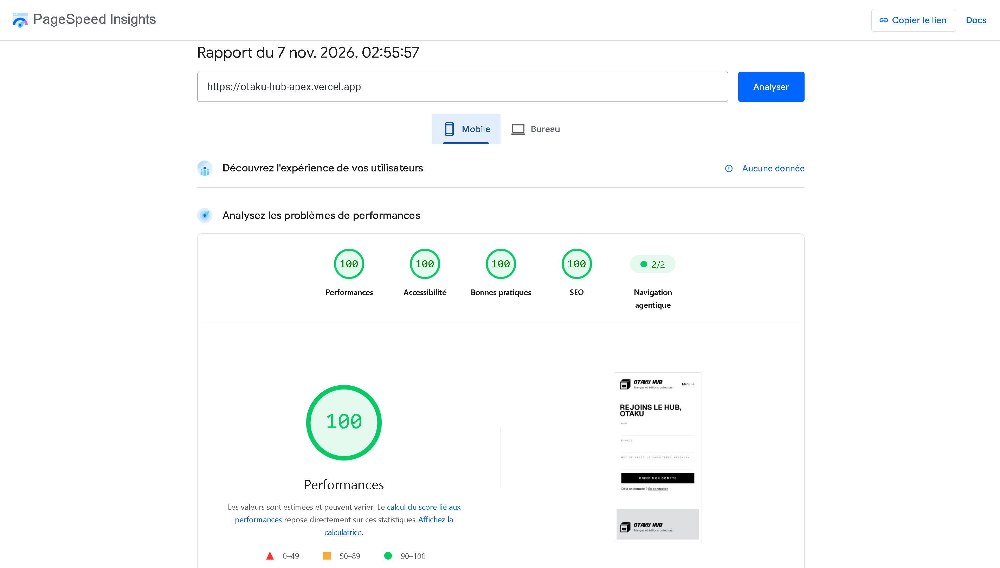
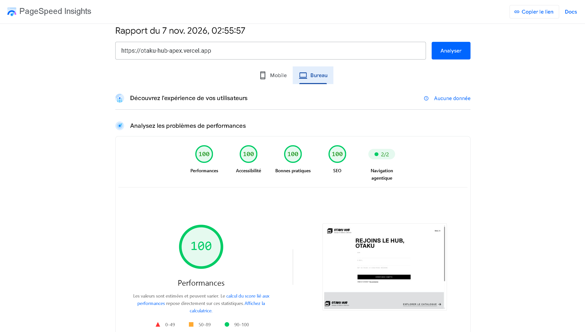

# Otaku Hub - Apex Stack (S22)

Site de démonstration d'une boutique de mangas, construit avec Next.js, Auth.js et déployé sur Vercel.

Projet de groupe réalisé dans le cadre du livrable de Semaine 22 d'Akieni Academy, Cohorte 2.

## Démo en ligne

- URL de production : [Otaku Hub](https://otaku-hub-apex.vercel.app/)
- Route de santé : [/api/health](https://otaku-hub-apex.vercel.app/api/health)
- Compte de test : `demo@otaku-hub.test` / `Demo1234!`

QR code vers la démo en ligne


## Sommaire

- [Otaku Hub - Apex Stack (S22)](#otaku-hub---apex-stack-s22)
  - [Démo en ligne](#démo-en-ligne)
  - [Sommaire](#sommaire)
  - [Contexte](#contexte)
  - [Fonctionnalités](#fonctionnalités)
  - [Rendu](#rendu)
  - [Stack technique](#stack-technique)
  - [Démarrage rapide](#démarrage-rapide)
  - [Variables d'environnement](#variables-denvironnement)
  - [Structure du projet](#structure-du-projet)
    - [Organisation des dossiers](#organisation-des-dossiers)
  - [Déploiement](#déploiement)
  - [Audit Lighthouse](#audit-lighthouse)
  - [Limites connues et pistes d'amélioration](#limites-connues-et-pistes-damélioration)
  - [Équipe](#équipe)
  - [Workflow Git](#workflow-git)
  - [Documentation du dépôt](#documentation-du-dépôt)
  - [Liens : Live + Repository + README](#liens--live--repository--readme)

## Contexte

Otaku Hub est une boutique en ligne de démonstration dédiée aux mangas et aux éditions collectors. L'application permet aux visiteurs de découvrir un catalogue de produits, de consulter leurs fiches détaillées et de créer un compte pour accéder aux fonctionnalités personnalisées.

C'est un exercice pratique, pas un vrai site de vente : il n'y a aucun paiement en ligne et aucune vraie commande. Le panier sert surtout à illustrer le rendu côté serveur d'une page qui dépend de l'utilisateur connecté.

Le projet répond au livrable S22 : une application Next.js avec authentification, déployée sur Vercel, qui illustre les trois stratégies de rendu (SSG, ISR, SSR). Il est réalisé en une semaine, du 02 au 06 novembre 2026.

## Fonctionnalités

- **Catalogue :** consultation des mangas disponibles et affichage des informations des produits.
- **Fiches produits :** consultation des détails d'un manga, notamment son titre, son auteur, sa description, son prix et sa couverture.
- **Authentification :** création de compte, connexion et déconnexion avec Auth.js.
- **Panier :** ajout de produits et gestion du panier associé à l'utilisateur connecté.
- **Profil :** accès à l'espace personnel de l'utilisateur authentifié.
- **Pages institutionnelles :** accueil, présentation du projet et formulaire de contact.
- **API :** routes dédiées à l'authentification, au contact et à la vérification de l'état de l'application.

Le projet ne propose ni paiement en ligne ni traitement de commandes réelles.

## Rendu

Chaque page utilise la stratégie adaptée à son contenu et à ses données.

| Stratégie | Pages | Justification |
|---|---|---|
| SSG (génération statique) | Accueil, à propos, contact | Ces pages sont pré-générées au build, car leur contenu est public et change peu. |
| ISR (régénération incrémentale) | Catalogue | Les données viennent du catalogue en base. La page est régénérée au plus toutes les 60 secondes pour tenir compte des changements sans refaire tout le build. |
| Rendu à la demande | Fiches produit | Le code déclare `revalidate = 60`, mais en production la réponse n'est pas mise en cache (`X-Vercel-Cache: MISS`, `no-store`) : la page est générée à chaque visite. La vraie mise en cache ISR reste à faire (voir pistes d'amélioration). |
| SSR (rendu serveur) | Panier, profil, connexion, inscription | Ces pages vérifient la session et adaptent leur contenu ou leur redirection à l'utilisateur connecté. |

La protection des routes `/panier` et `/profil` est assurée par `src/proxy.ts` (le proxy est le nouveau nom du middleware dans Next.js 16).

Les routes API ne sont pas des pages et ne sont donc pas incluses dans ce tableau.

## Stack technique

| Domaine | Technologies |
|---|---|
| Framework | Next.js 16 (App Router) |
| Bibliothèque UI | React 19 |
| Langage | TypeScript 5 |
| Style | Tailwind CSS 4 |
| Composants UI | shadcn/ui, Base UI |
| Icônes | Lucide React, Hugeicons |
| Authentification | Auth.js (NextAuth.js v5) |
| Sécurité des mots de passe | bcryptjs |
| Base de données | PostgreSQL sur Neon |
| ORM | Drizzle ORM |
| Animations | GSAP, Motion |
| Effets visuels | OGL |
| Hébergement | Vercel |
| Qualité du code | ESLint |
| Versionnement | Git et GitHub |
| Automatisation | GitHub Actions |

## Démarrage rapide

Prérequis : Node.js 20 ou plus récent, npm et Git.

```bash
# Cloner le dépôt
git clone https://github.com/KazeHolloway/s22-apex-stack-otaku-hub.git

# Entrer dans le dossier
cd s22-apex-stack-otaku-hub

# Installer les dépendances
npm install

# Créer le fichier d'environnement local à partir du modèle
cp .env.example .env.local

# Lancer le serveur de développement
npm run dev
```

L'application est ensuite disponible sur http://localhost:3000.

Autres commandes utiles :

```bash
# Vérifier le code avec ESLint
npm run lint

# Construire la version de production
npm run build
```

## Variables d'environnement

Le fichier `.env.example` liste les variables nécessaires, sans aucune valeur secrète. Le vrai fichier `.env.local` n'est jamais envoyé sur GitHub.

Sur Vercel, les variables se configurent dans Settings, puis Environment Variables.

## Structure du projet

Arborescence actuelle du projet (les dépendances, fichiers générés et fichiers d'environnement locaux sont exclus).

```text
s22-apex-stack-otaku-hub/
├── .github/
│   └── workflows/
│       ├── lighthouse.yml
│       └── secret.yml
├── docs/
│   ├── images/
│   │   └── qrcode-otaku-stack.png
│   ├── lighthouse/
│   │   ├── lighthouse-bureau.png
│   │   └── lighthouse-mobile.png
│   ├── brand.md
│   └── mvp.md
├── public/                   # Fichiers statiques (images, favicon)
│   ├── mangas/
│   ├── hero_*.jpg
│   ├── logo.svg
│   └── ... (autres ressources graphiques)
├── src/
│   ├── app/                  # Pages et routes (App Router)
│   │   ├── a-propos/
│   │   │   └── page.tsx
│   │   ├── api/
│   │   │   ├── auth/
│   │   │   │   └── [...nextauth]/
│   │   │   │       └── route.ts
│   │   │   ├── contact/
│   │   │   │   └── route.ts
│   │   │   └── health/
│   │   │       └── route.ts
│   │   ├── catalogue/
│   │   │   ├── [id]/
│   │   │   │   └── page.tsx
│   │   │   └── page.tsx
│   │   ├── connexion/
│   │   │   ├── actions.ts
│   │   │   └── page.tsx
│   │   ├── contact/
│   │   │   └── page.tsx
│   │   ├── inscription/
│   │   │   ├── actions.ts
│   │   │   └── page.tsx
│   │   ├── panier/
│   │   │   └── page.tsx
│   │   ├── profil/
│   │   │   └── page.tsx
│   │   ├── favicon.ico
│   │   ├── globals.css
│   │   ├── icon.svg
│   │   ├── layout.tsx
│   │   └── page.tsx
│   ├── components/           # Composants réutilisables
│   │   ├── ui/
│   │   │   └── button.tsx
│   │   ├── AddToCartButton.tsx
│   │   ├── BoutonAjouterAuPanier.tsx
│   │   ├── ButtonPrimary.tsx
│   │   ├── ContactForm.tsx
│   │   ├── FormulaireConnexion.tsx
│   │   ├── FormulaireInscription.tsx
│   │   ├── Footer.tsx
│   │   ├── HeroUne.tsx
│   │   ├── InfoPageHero.tsx
│   │   ├── Aurora.jsx
│   │   ├── FlexCarousel.jsx
│   │   ├── FlowingMenu.tsx
│   │   ├── Menu.jsx
│   │   ├── ScrollVelocity.tsx
│   │   └── StaggeredMenu.jsx
│   ├── fonts/
│   │   └── KOMIKAX_.ttf
│   ├── lib/                  # Fonctions utilitaires et accès aux données
│   │   ├── actions/
│   │   │   └── panier.ts
│   │   ├── db/
│   │   │   ├── ERD.md
│   │   │   ├── index.ts
│   │   │   ├── schema.ts
│   │   │   └── seed.ts
│   │   ├── catalogue.ts
│   │   ├── panier.ts
│   │   ├── produits.ts
│   │   ├── utilisateurs.ts
│   │   ├── utils.ts
│   │   └── uuid.ts
│   ├── auth.ts
│   └── proxy.ts
├── .env.example              # Modèle des variables d'environnement
├── .gitignore
├── AGENTS.md
├── CHANGELOG.md              # Historique des versions
├── CODE_OF_CONDUCT.md        # Guide de conduite
├── CONTRIBUTING.md           # Guide de contribution
├── README.md
├── components.json
├── drizzle.config.ts
├── eslint.config.mjs
├── lighthouserc.json
├── next.config.ts
├── package.json
├── package-lock.json
└── tsconfig.json
```

### Organisation des dossiers

- `src/app/` : pages de l'application et routes API avec Next.js App Router.
- `src/components/` : composants réutilisables de l'interface.
- `src/lib/` : logique métier, accès aux données et fonctions utilitaires.
- `src/lib/db/` : configuration, schéma et initialisation de la base de données.
- `src/fonts/` : polices locales.
- `public/` : images, couvertures de mangas, logos et ressources statiques.
- `docs/` : documentation fonctionnelle et identité visuelle.
- `.github/workflows/` : automatisations GitHub Actions.


## Déploiement

L'application est déployée sur [Vercel](https://vercel.com/) et utilise une base de données PostgreSQL hébergée sur [Neon](https://neon.tech/).

Checklist de déploiement :

- [x] Projet Vercel relié au dépôt GitHub
- [x] Variables d'environnement configurées sur Vercel
- [x] Base Neon créée et connectée
- [x] URL de production stable notée dans ce README
- [x] Aucun secret dans le dépôt

## Audit Lighthouse

L'application fait l'objet d'un contrôle de qualité avec Lighthouse.

**Critères de validation :**
- Performance : au moins 80/100 sur mobile.
- Accessibility : au moins 80/100 sur mobile.

Mesures sur la production ([otaku-hub-apex.vercel.app](https://otaku-hub-apex.vercel.app/)), faites le 7 novembre 2026, avec Lighthouse sur [PageSpeed Insights](https://pagespeed.web.dev/analysis/https-otaku-hub-apex-vercel-app-inscription/puaf0m8j47?form_factor=mobile) :

| Appareil | Performance | Accessibility | Best Practices | SEO | Agentic Browsing |
|---|---|---|---|---|---|
| Mobile | 100 | 100 | 100 | 100 | 2/2 |
| Bureau | 100 | 100 | 100 | 100 | 2/2 |

Le score de performance varie d'un test à l'autre selon le réseau et la machine. Dans l'onglet Lighthouse du navigateur, Best Practices peut afficher 96 à cause d'un message du panneau Issues de Chrome sur la politique de sécurité (CSP), absent des autres mesures ([PageSpeed Insights](https://pagespeed.web.dev/), ligne de commande.)

**Captures d'audit Lighthouse :**





Configuration de l'audit : `lighthouserc.json` et `.github/workflows/lighthouse.yml`.

## Limites connues et pistes d'amélioration

Limites actuelles :
- Aucun paiement ni commande réelle, c'est un site de démonstration.
- Le formulaire de contact n'enregistre rien.
- Les prix sont stockés en centimes d'euro, leur affichage en FCFA est à corriger.
- Pas de récupération de mot de passe, pas d'interface d'administration, pas de tests automatisés.
- Le mot de passe du compte de démonstration est public et la base est partagée.

Pistes d'amélioration :
- Inscription : bouton pour afficher ou masquer le mot de passe, champ de confirmation, redirection vers la page de connexion.
- Notifications (toasts) à l'ajout et au retrait d'un article du panier.
- Responsive : plus de points de rupture pour tablettes et petits téléphones (menu, logo, marges).
- Bouton Menu : icône burger qui se transforme en croix.
- Mode clair et sombre.
- Conversion correcte euro vers FCFA.
- Fiches produit : obtenir une vraie mise en cache ISR (aujourd'hui rendues à chaque visite).
- Suppression de l'option `ignoreBuildErrors` et correction des erreurs de types qu'elle masque.
- Politique de sécurité du contenu (CSP) à mettre en place avec des tests sur GSAP et les scripts de Next.

## Équipe

Groupe 2 (Apex Stack), Akieni Academy, Cohorte 2.

| Membre | Compte GitHub | Rôle S22 |
|---|---|---|
| MASSAMBA BOUESSO Christophe Darly | [KazeHolloway](https://github.com/KazeHolloway) | Déploiement, Admin Repo |
| MBOUSSA Emmanuelito | [elyseeMB](https://github.com/elyseeMB) | Rendu et performance, Lead |
| KOY Jude Airich | [Deekskn](https://github.com/Deekskn) | Auth |
| OKANIA Patience Théo | [theos1401](https://github.com/theos1401) | Feature 1 |
| MOUKOUANGA TOMBET Brissam Josué | [BrissamDev](https://github.com/BrissamDev) | Feature 2 |

## Workflow Git

- Les branches `main` et `dev` sont protégées, aucune modification directe.
- Chaque travail se fait sur une branche dédiée, puis passe par une pull request relue par un autre membre.
- Les commits suivent la convention Conventional Commits.

Le détail est dans [CONTRIBUTING.md](CONTRIBUTING.md).

## Documentation du dépôt

- [Guide de contribution](CONTRIBUTING.md)
- [Guide de conduite](CODE_OF_CONDUCT.md)
- [Historique des versions](CHANGELOG.md)

## Liens : Live + Repository + README

- [Application en ligne](https://otaku-hub-apex.vercel.app/)
- [Repository GitHub](https://github.com/KazeHolloway/s22-apex-stack-otaku-hub)
- [Documentation README](https://kazeholloway.github.io/s22-apex-stack-otaku-hub/)