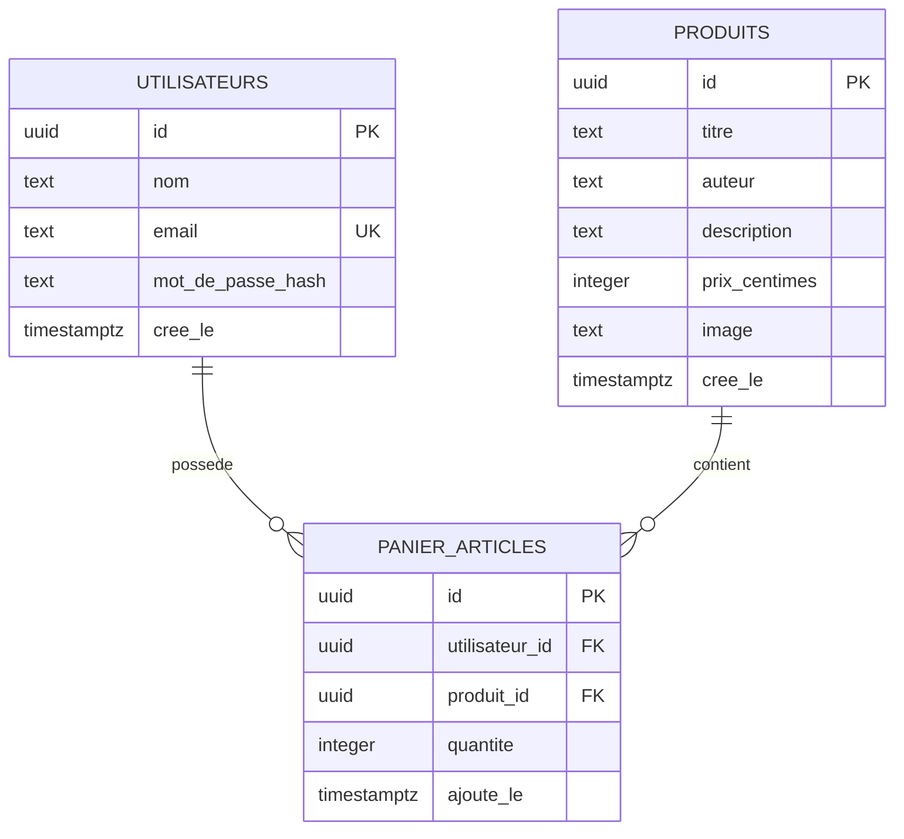

# Diagramme entité-relation

Base PostgreSQL (Neon) gérée avec Drizzle ORM. Tous les identifiants sont des UUID aléatoires.

## Contraintes

- `utilisateurs.email` : unique, et égal à `lower(email)` (CHECK), donc toujours en minuscules.
- `produits.prix_centimes` : supérieur ou égal à 0 (CHECK).
- `panier_articles.quantite` : 1 par défaut, entre 1 et 99 (CHECK).
- `panier_articles` : le couple (`utilisateur_id`, `produit_id`) est unique, un manga n'apparaît qu'une fois par panier.

## Règles de suppression

- Suppression d'un utilisateur : son panier est supprimé aussi (`ON DELETE CASCADE`).
- Suppression d'un produit : refusée s'il est dans un panier (`ON DELETE RESTRICT`).